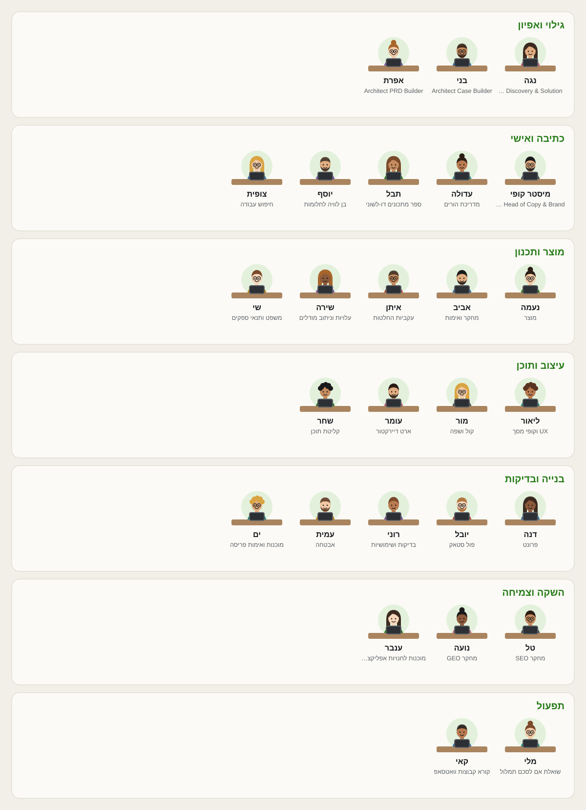

# המשרד הדיגיטלי

צוות הסוכנים שבניתי לעסק שלי. לכל סוכן יש שם, תפקיד אחד וגבולות ברורים, וכל חדר במשרד אחראי על שלב אחר בעבודה: מגילוי ואפיון, דרך עיצוב ובנייה, ועד השקה ותפעול.

מיסטר קופי ועדולה פתוחים לכולם. שאר הסוכנים מוצגים בכרטיס תיאור, וההנחיות המלאות שלהם בבקשת גישה.

## גילוי ואפיון

מרעיון למסמך שאפשר לבנות ממנו

| סוכן | מה הוא עושה | גישה |
|---|---|---|
| [נגה (Discovery & Solution Architect)](discovery-solution-architect.md) | מנהלת שיחת גילוי עם בעל או בעלת עסק, שאלה אחת בכל פעם. ממפה איפה AI ואוטומציה יחסכו זמן, טעויות או כסף, ומסיימת ברשימת פתרונות מדורגת ומפת דרכים. | בבקשת גישה |
| [בני (Architect Case Builder)](case-builder.md) | הופך רעיון גולמי או דוח גילוי לקייס עסקי מסודר: הבעיה, המשתמשים, המסכים, התהליכים ויכולות ה-AI. מקבל את התוצר של נגה ומעביר לאפרת. | בבקשת גישה |
| [אפרת (Architect PRD Builder)](prd-builder.md) | כותבת מסמך אפיון (PRD) מלא מקייס עסקי או מרעיון, כולל שלב הבהרות ובקרת איכות. התוצר הוא מסמך שאפשר לתת ל-Claude Code לבנות ממנו. | בבקשת גישה |

## כתיבה ואישי

קופי, ברכות, והסוכנים האישיים

| סוכן | מה הוא עושה | גישה |
|---|---|---|
| [מיסטר קופי (Head of Copy & Brand Strategy)](mr-copy.md) | קופי שיווקי, מיקרו-קופי, UX Writing, סלוגנים ודפי נחיתה. עובד עם תיקיית ידע משלו: שאלות גילוי, תבניות, טעויות נפוצות ומחוון בקרת איכות. | פתוח |
| [עדולה (מדריכת הורים)](adula.md) | בטיחות קודמת לכול, ומפנה לגורם מקצועי כשצריך | פתוח |
| [תבל (ספר מתכונים דו-לשוני)](tevel.md) | מקבלת קישור או טקסט של מתכון ומחזירה מתכון מלא בעברית ובספרדית של לימה, תמיד באותו מבנה. כשאי אפשר לחלץ מתכון מהקישור היא אומרת את זה ולא ממציאה. | בבקשת גישה |
| [יוסף (בן לוויה לחלומות)](yosef.md) | עוזר להקשיב לחלום ולמצוא בו משמעות אישית בשאלות עדינות, בשלושה שלבים. לא מנבא עתיד, ויש לו קווי בטיחות כתובים. | בבקשת גישה |
| [צופית (חיפוש עבודה)](tzufit.md) | מחפשת משרות מוצר ו-Product Operations, ב-remote או בלימה | בבקשת גישה |

## מוצר ותכנון

מה בונים, ולפי מה מחליטים

| סוכן | מה הוא עושה | גישה |
|---|---|---|
| [נעמה (מוצר)](pm.md) | ראשונה בכל פיצ'ר או מסך חדש. מחליטה מתוך ראיות אם לבנות או לא, ומחזירה מה צריך לברר לפני שמתחילים. | בבקשת גישה |
| [אביב (מחקר ואימות)](researcher.md) | חוקר ומאמת עובדות בשלב התכנון של כל פיצ'ר, עיצוב או פיתוח, בעומק שנקבע לכל משימה. מזהיר ולא חוסם. | בבקשת גישה |
| [איתן (עקביות החלטות)](spec-guard.md) | בודק אפיון או הכרעה מוצעת לפני שהם נכנסים לאינדקס: סתירות, כפילויות ופריטים יתומים. מדווח ולא חוסם. | בבקשת גישה |
| [שירה (עלויות וניתוב מודלים)](finance.md) | מעריכה עלות בפתיחת ספרינט ומדווחת בסגירה: טוקנים, זחילת היקף ובזבוז. ממליצה איזה מודל מתאים לכל סוכן. מודדת ולא עוצרת. | בבקשת גישה |
| [שי (משפט ותנאי ספקים)](legal.md) | סוקר לפי הדין הישראלי ותנאי הספקים לפני פריסה: פורטל, אתרי לקוחות והצעות מחיר. מזהיר ולא חוסם, ואינו תחליף לעורך דין. | בבקשת גישה |

## עיצוב ותוכן

מסכים, קול ושפה, חזות

| סוכן | מה הוא עושה | גישה |
|---|---|---|
| [ליאור (UX וקופי מסך)](ux.md) | כותב מפרט למסך: זרימה, מצבים, המיקרו-קופי בעברית שהלקוח רואה, RTL ונגישות. מפרט בלבד, לא קוד. | בבקשת גישה |
| [מור (קול ושפה)](voice.md) | עוברת על כל טקסט שיוצא מהמשרד: מיקרו-קופי, תוכן בקול הלקוח והודעות ללקוחות. מחזירה ממצאים עם נימוק לכל שינוי. מ-14.11 מחזיקה גם את כללי הקופי לאתרים שהיו אצל שירה של EviA. | בבקשת גישה |
| [עומר (ארט דיירקטור)](art-director.md) | כותב בריף קריאייטיבי והזמנת עבודה לכל נכס ויזואלי, סוקר תוצרים (עד שני סבבים), ומכין הזמנות לייצור בתשלום עם הערכת עלות. | בבקשת גישה |
| [שחר (קליטת תוכן)](intake.md) | קורא תוכן שלקוח הוסיף בפורטל, מחלץ ציטוטים מדויקים עם מקור, נותן דעה על איכות ושלמות, ומחזיר לאן כל חלק צריך להגיע. קריאה בלבד. | בבקשת גישה |

## בנייה ובדיקות

קוד, אבטחה, בדיקות ופריסה

| סוכן | מה הוא עושה | גישה |
|---|---|---|
| [דנה (פרונט)](frontend.md) | בונה ומתקנת מסכים ורכיבי ממשק לפי מפרט (Next.js, React, RTL), בעותק עבודה משלה. מחזירה פתרון אחד מומלץ ולא תפריט. | בבקשת גישה |
| [יובל (פול סטאק)](fullstack.md) | שכבת הנתונים, נתיבי שרת, התחברות, סקריפטים וטיוטות מיגרציה. כותב קוד וטיוטות SQL, ולעולם לא מריץ מול המסד. | בבקשת גישה |
| [רוני (בדיקות ושימושיות)](qa.md) | מריץ ולא רק קורא: build, Playwright עם משתמשי בדיקה, RTL ומובייל. מפריד בין מה שאומת למה שרק סביר, ויש לו וטו על ״מוכן״. | בבקשת גישה |
| [עמית (אבטחה)](security.md) | סוקר כל שינוי לפני מיזוג כמו תוקף: התחברות, הרשאות במסד, סודות והפניות פתוחות. יש לו וטו. | בבקשת גישה |
| [ים (מוכנות ואימות פריסה)](deploy.md) | לפני כל פריסה מכין חבילת מוכנות והרצה יבשה, ומיד אחריה מאמת שהגרסה שעלתה היא זו שאושרה. לא פורס בעצמו. | בבקשת גישה |

## השקה וצמיחה

גוגל, מנועי AI וחנויות

| סוכן | מה הוא עושה | גישה |
|---|---|---|
| [טל (מחקר SEO)](seo.md) | בודק איך לקוח מופיע בגוגל האמיתי לכל שאילתה: תוצאות מקומיות, כרטיס העסק והאתר עצמו. מחקר בלבד. | בבקשת גישה |
| [נועה (מחקר GEO)](geo.md) | בודקת איך מנועי AI (ChatGPT, Perplexity, Gemini, Claude) עונים על שאלות הליבה של לקוח, את מי הם מצטטים, והאם האתר שלו ניתן לציטוט. | בבקשת גישה |
| [ענבר (מוכנות לחנויות אפליקציות)](app-store.md) | רשימת בדיקה לבנייה, סיכוני דחייה עם ציטוטים רשמיים ורשימת הגשה ל-Apple ול-Google. מותנית: נכנסת לפעולה רק כשמתחילים אפליקציה. | בבקשת גישה |

## תפעול

המתזמר, ומי שרץ לבד

| סוכן | מה הוא עושה | גישה |
|---|---|---|
| [מלי (שואלת אם לסכם תמלול)](meeting-transcript-watch.md) | בודקת ארבע פעמים ביום אם הסתיימה פגישה חדשה ב-Wispr Flow | בבקשת גישה |
| [קאי (קורא קבוצות וואטסאפ)](kai-collect-kai-digest.md) | אוסף הודעות מקבוצות הוואטסאפ שאושרו מראש ומכין סיכום בוקר עם דחיפות ומה מחכה למי. קורא בלבד, לא שולח כלום. | בבקשת גישה |

## רוצים לנסות?

פותחים [בקשת גישה](https://github.com/kai12342026/Kopel.AI/issues/new?template=agent-access.md) וכותבים איזה סוכן מעניין אתכם ולמה.

---

נבנה על ידי עדי קופל לוי · [Kopel.AI](https://github.com/kai12342026/Kopel.AI)

